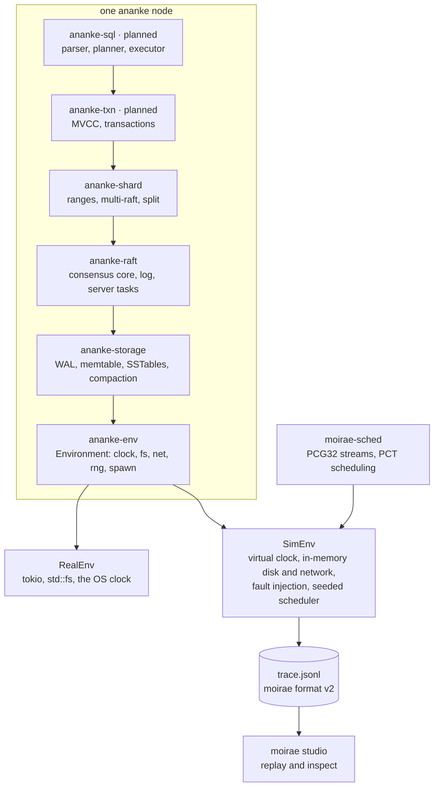
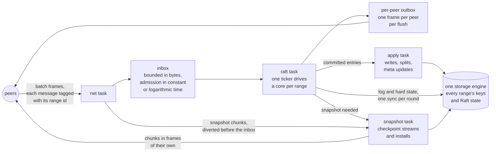
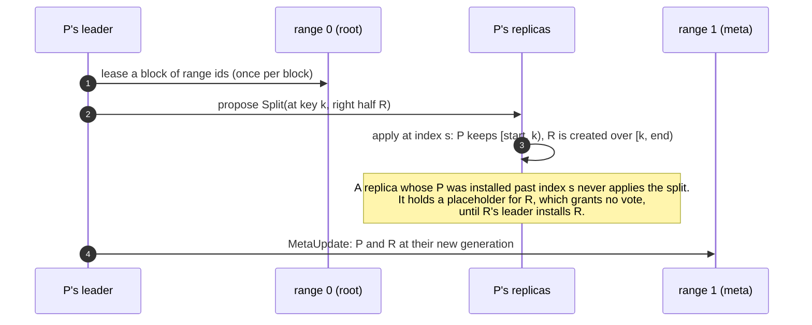
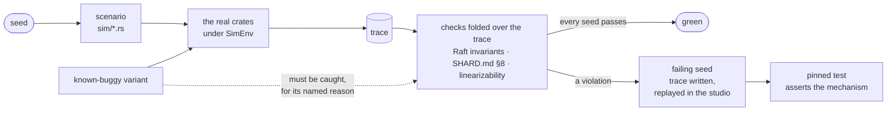

<div align="center">

# ananke

**A distributed SQL database in Rust, built so that every failure it can have is reproducible.**

[](https://github.com/pchrysostomou/ananke/actions/workflows/ci.yml)
[](https://github.com/pchrysostomou/ananke/actions/workflows/nightly.yml)
[](rust-toolchain.toml)
[](#license)

[Why](#why-ananke) · [Architecture](#architecture) · [How simulation works](#how-simulation-works) · [How correctness is argued](#how-correctness-is-argued) · [Status](#status) · [Bugs found](#bugs-the-simulator-has-found) · [Run it](#run-it) · [Layout](#repository-layout) · [Docs](#documentation)

</div>

---

## Why ananke

Distributed databases fail in ways that do not happen twice: a lost `fsync` during a
partition, a crash between two writes, a message delivered after a leader stepped down.
ananke is built so that every such failure can be replayed, understood and kept as a
test.

Every source of non-determinism the code touches goes through one `Environment` trait:
disk, network, clock, randomness and task scheduling. The same code that runs on real
machines runs inside a deterministic simulator, which injects the faults under a seed.

- **One seam for all I/O.** Every crate is generic over `E: Environment`. Direct calls
  to `std::time`, `std::fs`, `std::net`, tokio's I/O, `rand` or thread spawning are
  rejected by clippy and by a textual second check.
- **Faults the real world has.** Torn writes, lost fsyncs, bit rot, lost directory
  entries; dropped, duplicated and delayed messages, partitions and one-way blocks;
  clock skew and drift; crashes and restarts. All of them are drawn from the seed.
- **Byte-for-byte replay.** A failing seed replays exactly on the tree that found it,
  and its trace opens in a visual studio.
- **Every bug class comes as a pair.** For each failure mode there is a deliberately
  broken variant the sweep must catch, and the correct code it must pass, on the same
  seeds.
- **Every decision is written down.** `docs/DECISIONS.md` holds over 120 entries, and
  none is ever deleted.

> In Greek myth Ananke is necessity, and the Fates, the Moirai, are her daughters. The
> simulator's traces and scheduling come from [moirae](https://github.com/pchrysostomou/moirae),
> a deterministic-simulation-testing framework with a trace replay studio. ananke is
> moirae's largest user, and moirae is ananke's test harness.

### At a glance

| | |
|---|---|
| **Code** | About 128 000 lines of Rust: 72 000 in the crates, 56 000 in the simulation and its checks |
| **Released** | Phase 0 (the runtime and simulator), Phase 1 (the storage engine) and Phase 2 (Raft), tagged `v0.1.0` to `v0.3.0` |
| **In progress** | Phase 3, multi-raft sharding. Stages A and B are done (tag `phase-3-stage-b`). Stage C (descriptors, routing, the meta range and split) is nearly done |
| **Seeds per change** | 20 at the gate, 100 in CI, 1 000 before a merge (100 for the released phases' sweeps, D-094), 10 000 every night in seven parallel jobs; a variant caught at a high rate runs a tenth of the tier, never under 20 (D-061), and a few costly sweeps run a capped or fixed count (D-081, D-083) |
| **Known-buggy variants** | 20 in the Raft core, 52 in the node and 11 in the range layer, plus 4 in the WAL and 12 in the engine |
| **Checks read off the trace** | 14 of the 22 numbered checks of [SHARD.md §8](docs/SHARD.md): Raft's five invariants, the first four keyed by range and the fifth, linearizability, per key across every split, and lease safety under drift (checks 1 to 6); and the range layer's checks 7 to 10, 16 to 18 and 20. The tiling check (19) comes with S7, and the move and merge checks (11 to 15, 21, 22) with Stages D and E |

---

## Architecture

### The layers

Each layer is a crate, and each crate is generic over the `Environment` beneath it.
Nothing above `ananke-env` knows whether it runs on a real machine or inside the
simulator.



The design of each layer is a section of the [SPEC](docs/SPEC.md). Raft's is
[RAFT.md](docs/RAFT.md) and the range layer's is [SHARD.md](docs/SHARD.md).

### Inside one node

Phase 3 runs many Raft groups, one per range, on each node. They share one socket, one
ticker and one storage engine, so that a node does not need a socket and a ticker per
range. Phase 3 proves this at 1 000 ranges, about 300 replicas a node on ten nodes;
10 000 ranges is a non-goal (SHARD.md §4).



### The keyspace

A range is a contiguous interval `[start, end)` of encoded keys, and the ranges tile the
keyspace. Two system ranges hold the map. **Range 0, the root**, is found through
configuration; it holds meta's descriptor and the node records, and hands out range ids
in blocks. **Range 1, meta**, holds a record of every user range's descriptor (span,
generation, voters). Clients cache descriptors. A server that finds a key outside its
span answers with the descriptors it holds, which the client merges in by generation; it
reads meta only when its cache has no entry for the key or the answer named none.

A split happens in the parent's own log, so every replica applies it at the same index:



SHARD.md covers merge, rebalancing, the client cache and what breaks at 1 000 and
10 000 ranges.

---

## How simulation works

Under `Sim`, a scenario adds nodes, spawns their tasks on `sim.env(node)`, and drives
virtual time with `run_for`, `run_steps`, `crash`, `restart`, `partition` and `heal`.
Time is `ananke_env::Instant`. Hash maps are seeded from the environment's random
stream, so even iteration order is part of the seed.

- **The disk** (SPEC §1.3). A write is visible at once and durable only after `sync`.
  A `sync` can return Ok and persist nothing, with probability `1 - p_durable`. At a
  crash, a random prefix of the pending writes survives and the next write may survive
  as a torn prefix. One bit per block flips with probability `p_bitrot`, and a random
  prefix of each directory's unsynced creates, removes and renames survives.
- **The network** (SPEC §1.4). Messages can be dropped, duplicated with a delay of
  their own, or delayed. Partitions can be symmetric or block one way only.
- **The scheduler.** It picks which runnable task to poll next, uniformly or with
  probabilistic concurrency testing, per seed.

Every state transition that matters is a trace event. This is seed 42 of the echo
scenario's negative control, `NoSyncDir`, which never syncs the directory at rotation, at
the moment node 3 crashes, from the trace whose hash `sim/tests/echo.rs` pins:

```jsonl
{"t":1100000000,"seq":969,"kind":"log","node":3,"event":"ananke.fs.bit-rot","data":{"path":"/echo/journal.prev","block":0,"offset":212,"bit":4}}
{"t":1100000000,"seq":970,"kind":"log","node":3,"event":"ananke.fs.write-torn","data":{"path":"/echo/journal","offset":96,"written":16,"kept":14}}
{"t":1100000000,"seq":971,"kind":"log","node":3,"event":"ananke.fs.dir-entry-lost","data":{"dir":"/echo","entry":"/echo/journal.prev","op":"rename"}}
{"t":1100000000,"seq":972,"kind":"log","node":3,"event":"ananke.fs.dir-entry-lost","data":{"dir":"/echo","entry":"/echo/journal","op":"link"}}
{"t":1100000000,"seq":973,"kind":"log","node":3,"event":"ananke.fs.dir-entry-lost","data":{"dir":"/echo","entry":"/echo/journal.prev","op":"rename"}}
{"t":1100000000,"seq":974,"kind":"log","node":3,"event":"ananke.fs.dir-entry-lost","data":{"dir":"/echo","entry":"/echo/journal","op":"link"}}
{"t":1100000000,"seq":975,"kind":"log","node":3,"event":"ananke.fs.dir-entry-lost","data":{"dir":"/echo","entry":"/echo/journal.prev","op":"rename"}}
{"t":1100000000,"seq":976,"kind":"log","node":3,"event":"ananke.fs.dir-entry-lost","data":{"dir":"/echo","entry":"/echo/journal","op":"link"}}
{"t":1100000000,"seq":977,"kind":"fault","fault":"crash","node":3,"cause":"schedule"}
{"t":1100000000,"seq":978,"kind":"fault","fault":"restart","node":3}
```

In that one instant, a bit of the rotated journal flipped, the last record lost two of
its sixteen bytes, and the renames and creates of the last three rotations, which this
variant never syncs, did not survive. The correct journal, the one `ananke-server` ships,
syncs the directory after every rename and create. A Raft record can also carry
`decidedNs`, the time its step was decided, where that came before what it reports was
durable (D-047). Checks about *why* a server acted read the decision time.

---

## How correctness is argued

Passing tests is not the bar here. The bar is tests that would fail if the code were
wrong, and the repository's rules are built around that.



- **The pair rule.** Each check has a test that the correct system passes and a variant
  that trips it for the reason it names, on the same seeds. A sweep that only passes may
  not be injecting the fault at all.
- **A test must be able to fail.** Reviews plant the bug and confirm the test goes red.
  Checks found unable to fail are bugs in their own right (see below).
- **A pinned seed asserts its mechanism, never just green.** A seed's schedule moves
  whenever the code does, so a pin asserts the situation it was pinned for, or its
  absence with the reason.
- **Four tiers of seeds** ([D-040](docs/DECISIONS.md), D-061): 20 at the gate, 100 in CI,
  1 000 before a merge and 10 000 every night. A variant caught on under 5 % of seeds
  asserts its catch only from the thousand, where the miss rate is negligible, and the
  fault's firing, wherever that is well above 5 %, at every tier. The released phases'
  sweeps run 100 before a merge (D-094), so their thin catches are asserted in the
  nightly alone.
- **Bounds are never widened to get green.** If the correct system trips a bound, the
  system or the reading is wrong, and the owner decides which.
- **Decisions are append-only.** Every choice the documents do not settle becomes an
  entry in [DECISIONS.md](docs/DECISIONS.md), marked PROPOSED until it is ruled on, and
  its code sites carry `PROPOSED(D-nnn)`.

---

## Status

### Components

| Crate | State today | Published |
|---|---|---|
| `ananke-env` | **Released.** The `Environment` trait (`Clock`, `FileSystem` with explicit `sync` and `sync_dir`, a message-oriented `Network`, `Rng`, `spawn`); `RealEnv` on tokio; `Sim` / `SimEnv` with the disk and network fault models, per-node clock skew and drift, and a poll budget; the moirae format v2 export | 0.2.0 on crates.io; 0.3.0 tagged here, not yet published |
| `ananke-storage` | **Released.** WAL, memtable, SSTables under a manifest, log truncation, versions, snapshots, scans, leveled compaction, write batches and checkpoints (D-018 to D-024, D-027, D-044) | 0.2.0 on crates.io; 0.3.0 tagged here, not yet published |
| `ananke-raft` | **Done and tagged.** A pure protocol core with pre-vote, read-index and lease reads with a drift guard, check quorum, leadership transfer, joint-consensus membership with learners, and snapshots streamed as resumable chunks of an engine checkpoint; its state in the storage engine; the server as `raft`, `net`, `apply` and `snapshot` tasks; lost-state refusal and re-seeding (D-025 to D-049). It runs under the simulator; no binary runs it on real sockets yet | Tagged `v0.3.0`; **never published**, so `cargo add ananke-raft` finds nothing |
| `ananke-shard` | **Phase 3, in progress (Stage C).** Many Raft groups per node over one socket, one ticker and one engine: range-tagged batch frames, the per-peer outbox, a bounded inbox; descriptors, the root and meta ranges, routing with a client cache; splits, with placeholders for right halves a replica has not made yet and range ids leased in blocks from the root; per-range snapshot streams and installs; lost-state refusal, re-seeding and quarantine across splits. Merge, moves and the rebalancer are Stages D and E | Not released |
| `ananke-server` | The node binary, Phase 0 protocol only: `ananke-server echo` runs the echo protocol on `RealEnv`, the same code the simulator runs | `publish = false` |
| `ananke-sim` (`sim/`) | The scenarios (`echo`, `wal`, `engine`, `raft`, `membership`, `install`, `ranges`, `reseed`, `split`, `quorum`, `shard`), the linearizability checker `lin.rs`, the trace folds and the parallel sweep driver | `publish = false` |
| `ananke` | A placeholder reserving the name | 0.1.0 and 0.2.0 on crates.io |
| `ananke-txn`, `ananke-sql` | Planned for Phases 4 and 5. No code yet | None |

### Phases

| Phase | Name | Exit criteria, in brief ([SPEC](docs/SPEC.md)) | State |
|---|---|---|---|
| 0 | Deterministic runtime (§1) | The echo protocol under partitions with its trace open in the studio; byte-identical traces for one seed, checked in CI; clippy's `disallowed-methods` for all direct I/O | ✅ `v0.1.0` · [devlog](docs/devlog/00-phase-0.md) |
| 1 | Storage engine (§2) | Random operations and crash points recover to the model's state; 10 000 seeds green nightly; over 200 000 writes/s single-threaded as a sanity number | ✅ `v0.2.0` · 299 169 writes/s in unsynced batches of a hundred · [devlog](docs/devlog/01-phase-1.md) |
| 2 | Raft (§3) | The five invariants across 10 000 seeds under the network and disk fault model; 3 → 5 → 3 under partition completes both ways with no gap in completed client operations over ten maximum election timeouts | ✅ `v0.3.0` · worst membership gap 549 ms against the 2 s bound · [devlog](docs/devlog/02-phase-2.md) |
| 3 | Multi-raft sharding (§4) | Linearizability across split, merge and rebalance under faults; a 1 000-range cluster stays balanced within 10 % after a node is added and removed | 🚧 Stages A and B done (`phase-3-stage-b`). Stage C: slices S1 to S11 on `main` except S7 (check 19) and S8 (c) (a re-seeded node's right halves), both being built since the owner's rulings on D-093 and D-107; S12 (meta reordering) and S13 (close-out) in progress. Then D (moves, collection) and E (merge, rebalancer). Plan: [#162](https://github.com/pchrysostomou/ananke/issues/162) |
| 4 | Transactions (§5) | elle reports no snapshot-isolation anomalies over simulation traces; an injected bug is caught within 100 seeds | Planned |
| 5 | SQL (§6) | A sqllogictest subset passes; `psql` connects and runs the demo schema | Planned |
| 6 | Security (§7) | A STRIDE-reviewed threat model; no plaintext user data recoverable from a dumped disk; a tamper-evident audit chain | Planned |
| 7 | External verification (§8) | A Jepsen suite against a real five-node deployment, fuzzing targets and a 24-hour chaos simulation | Planned |

---

## Bugs the simulator has found

Each was found by a seed, replayed from its trace, fixed, and pinned as a test that
asserts its mechanism.

### Phase 3: ranges ([SHARD.md](docs/SHARD.md))

- **An install that deleted its neighbours' data** (seeds 41, 119, 447, 466, 782, 793
  and 865, [D-128](docs/DECISIONS.md)). A re-seeded node got its configuration range
  back at its bootstrap span. Its install replaced that whole span and deleted the keys
  of right halves split off since. The linearizability checker named the keys. An
  install now replaces only the span the node holds.
- **A right half re-created without its quarantine** (seeds 3870 and 5303, D-130). A
  node refused for lost state was re-seeded below a split. It replayed the split, made
  the right half afresh with no quarantine, and voted. Entries 107 to 115 of term 2,
  already committed, were lost from the new majority. This was found by a review's
  10 000-seed run after the 1 000-seed premerge was green. A right half made on a
  quarantined parent now takes the quarantine.
- **An install that switched in a stale span** (seed 5620, D-132). The new workload
  shapes reached a split applied through the log while a snapshot of the same range was
  being installed. The switch used the span copied when the stream began, and removed
  the new right half's keys. The span is now read at the switch, and the applied index
  is checked again there. A split applied after the install is numbered can still
  remove those keys (seed 13283, past the nightly's range);
  [#225](https://github.com/pchrysostomou/ananke/issues/225) tracks it, and D-133
  ([#239](https://github.com/pchrysostomou/ananke/pull/239)) is its fix.
- **A leader that could never confirm a read** (seeds 128 and 643, D-129). With two of
  a range's three voters quarantined, the leader kept committing but could never confirm
  a read, and its outstanding reads grew without bound. By the owner's ruling, a leader
  now refuses the reads it can never confirm.
- **Checks that could not fail.** A review planted a retry that never took effect, and
  the check meant to catch it stayed green, because it measured from a point after the
  event. The harness had a bug too: a test client re-asked a write after a silence, so
  one write applied twice. Both are fixed, and both kinds are now looked for on purpose.

### Phase 2: Raft ([devlog](docs/devlog/02-phase-2.md))

- **The network wrote twice** (seed 42, [D-026](docs/DECISIONS.md)). A client request
  the network duplicated was proposed twice and a compare-and-set applied twice; the
  linearizability checker named the key. Leaders now deduplicate by client and sequence
  number while the entry is in the log.
- **A rotted length read as a torn tail** (seed 16, D-027). Bit rot in a synced
  record's length looked like a write torn at a crash, and a server's applied index went
  from 81 back to 68. The record header now carries its own checksum.
- **An adoption that was not crash-safe** (seed 6325, D-041). Adopting a staged
  snapshot removed the old store before the copies were durable. A crash inside it left
  a voter that remembered nothing.
- **Two snapshot-stream bugs** (seed 5909, D-043). Re-takes at one index shared a
  directory under a stream still reading it, and a leader streamed to one follower at a
  time.
- **A refusal that did not survive a restart** (seed 687, D-044). A server refused its
  store for lost state, but the refusal lived only in memory, and its engine went on
  flushing and deleted the evidence. The next restart opened clean, as a voter with a
  hole in its state machine.
- **Durability time read as decision time** (seeds 1885 and 2023, D-047). A term rise,
  traced once its persist was durable, was stamped inside an isolation that began after
  the decision. Records now carry both times.

### Phase 1: the storage engine ([devlog](docs/devlog/01-phase-1.md))

- **A hole in the log after a lost fsync** (seed 59, D-019). Recovery read records 1 to
  61, then 63 onward, every checksum valid. Records now carry their sequence number, and
  recovery stops at a gap.
- **An older write shadowed a newer one** (seed 420, D-021). Two writes to one key in
  one group were applied newer-first across a memtable rotation.
- **A flipped bit that named an older manifest** (D-022). Bit rot turned `000007` in
  `CURRENT` into `000003`, a manifest that still existed, and recovery deleted four newer
  tables as orphans. `CURRENT` now carries a crc32c.
- **A cut that came back** (seed 191, in the [Phase 1 devlog](docs/devlog/01-phase-1.md))
  and **a fallback onto deleted tables** (seed 44, D-022).

The full accounts, with seeds, traces and commits, are in the devlogs and in
[DECISIONS.md](docs/DECISIONS.md).

---

## Run it

```sh
git clone https://github.com/pchrysostomou/ananke && cd ananke
rustup toolchain install     # the toolchain pinned in rust-toolchain.toml

scripts/gate.sh              # rustfmt, clippy, the direct-I/O check, docs, every test (20 seeds)
scripts/premerge.sh          # every current sweep at 1 000 seeds (some fewer, see above) in release, catch rates printed
```

`scripts/gate.sh` is the one command that precedes every commit. Any tier can be run by
hand:

```sh
ANANKE_SEEDS=500 cargo test --release -p ananke-sim --test engine
ANANKE_SEEDS=1000 cargo test --release -p ananke-sim --all-features --test shard -- --nocapture
```

The main sweeps write each failing seed's trace to `sim/out/<scenario>-<seed>.jsonl`
(the re-seed and install sweeps do not yet), and the nightly uploads those as
artifacts. A seed runs the same whichever thread runs it, so to replay one, call its
scenario with it:

```rust
let report = ananke_sim::raft::run(5909, ananke_raft::core::Variant::Correct);
ananke_sim::write_trace("raft-5909", &report.jsonl()); // sim/out/raft-5909.jsonl
report.check().unwrap();
```

```sh
cargo test --release -p ananke-sim --all-features --test shard seeds_3870   # a pinned seed's tests
npx moirae replay sim/out/raft-42.jsonl                                     # open a trace in the studio
```

The three-process echo cluster on real sockets, one process per node:

```sh
cargo build -p ananke-server
target/debug/ananke-server echo --listen 127.0.0.1:7001 --peers 127.0.0.1:7002,127.0.0.1:7003 --duration-secs 3 &
target/debug/ananke-server echo --listen 127.0.0.1:7002 --peers 127.0.0.1:7001,127.0.0.1:7003 --duration-secs 3 &
target/debug/ananke-server echo --listen 127.0.0.1:7003 --peers 127.0.0.1:7001,127.0.0.1:7002 --duration-secs 3; wait
```

---

## Repository layout

```text
crates/
  ananke-env/        Environment trait; RealEnv on tokio; Sim and SimEnv with the fault models
  ananke-storage/    WAL and LSM engine: memtable, SSTables, manifest, compaction, checkpoints
  ananke-raft/       pure Raft core, its store, the server tasks, the trace invariants
  ananke-shard/      the range layer: frames, inbox and outbox, descriptors, meta, splits, installs
  ananke-server/     the node binary (the echo protocol today)
  ananke/            a placeholder reserving the name
sim/                 scenarios, sweeps, the linearizability checker, trace folds
  tests/             the tiered sweeps, variant pairs and pinned seeds
docs/                SPEC, RAFT, SHARD, DECISIONS, the devlogs
scripts/             gate.sh, premerge.sh, nightly.sh, the nightly's shard table and its check
.github/workflows/   ci.yml (100 seeds), nightly.yml (10 000 seeds in seven jobs)
```

---

## Documentation

| Document | What it holds |
|---|---|
| [docs/SPEC.md](docs/SPEC.md) | What each phase builds and how, and its exit criteria |
| [docs/RAFT.md](docs/RAFT.md) | The Raft variant, its invariants, how the trace checks each, and the known-buggy variants |
| [docs/SHARD.md](docs/SHARD.md) | Ranges, the meta range, routing, multi-raft, split, merge, rebalancing, the invariants and the stages |
| [docs/DECISIONS.md](docs/DECISIONS.md) | Why this over that: one entry per decision, never deleted |
| [docs/devlog/](docs/devlog/) | One post per phase, with the bugs and their traces |
| [docs/BACKLOG.md](docs/BACKLOG.md) | Where deferred ideas go: the issue tracker, by phase |
| [CONTRIBUTING.md](CONTRIBUTING.md) | The working agreements, for anyone sending a change |
| [CLAUDE.md](CLAUDE.md) | The same agreements, as an agent session reads them |

## Contributing

Read [CONTRIBUTING.md](CONTRIBUTING.md) first. In short: run `scripts/gate.sh` before
every commit; route all I/O through the `Environment`; ship every fault-model test as a
pair; trace every state transition; pin seeds by their mechanism; and record any
decision the documents do not settle in [DECISIONS.md](docs/DECISIONS.md) before
implementing it.

## License

Licensed under either of [Apache License 2.0](LICENSE-APACHE) or [MIT](LICENSE-MIT), at
your option.
